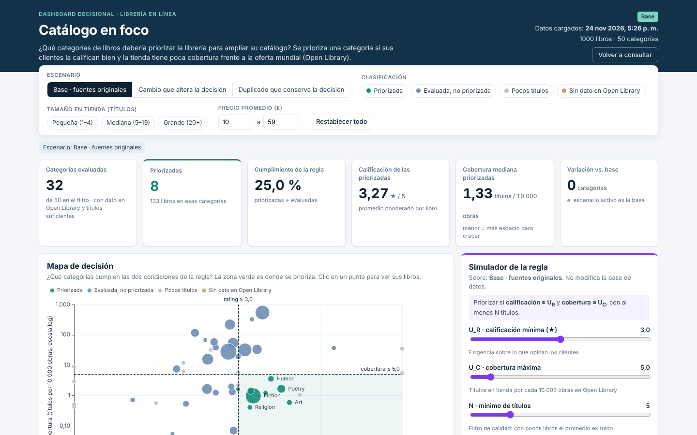
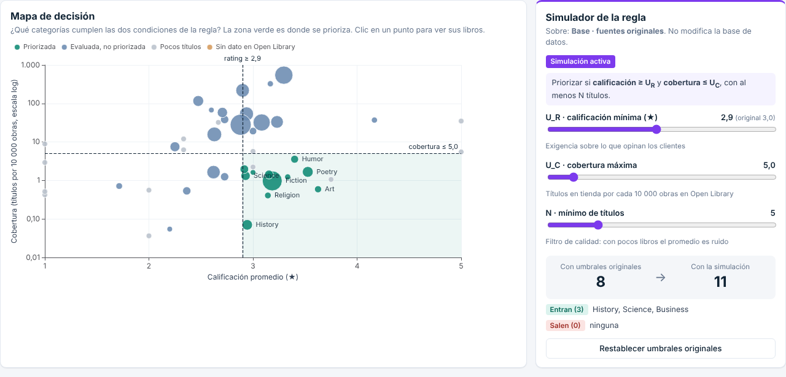
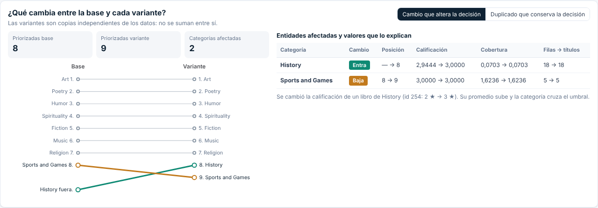
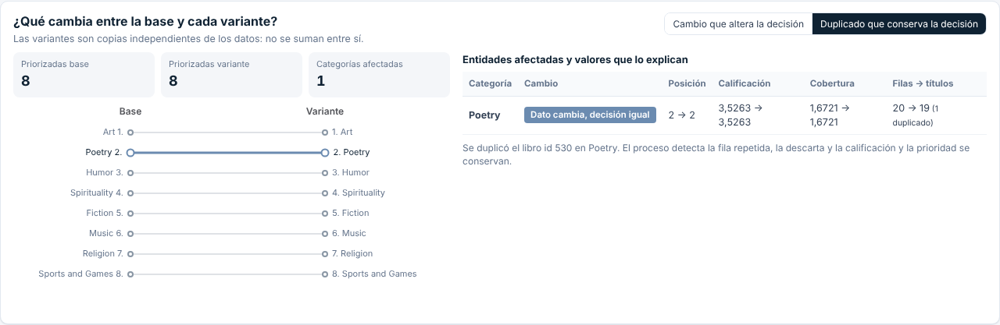
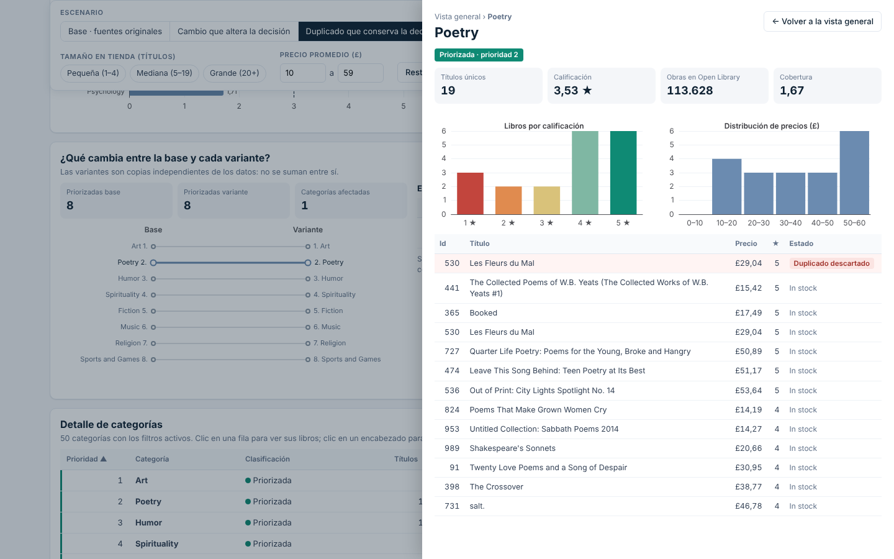
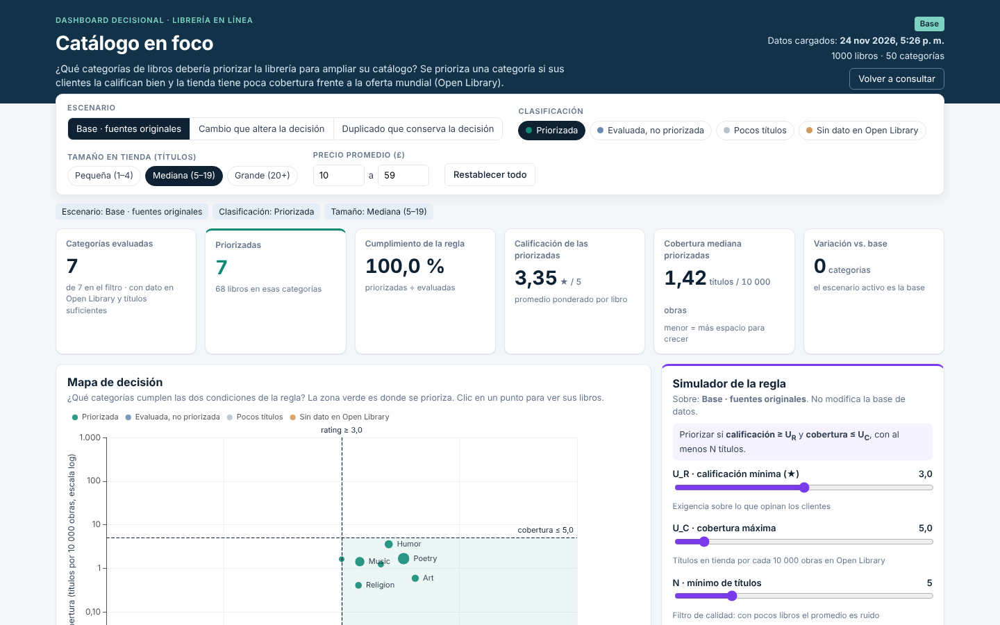
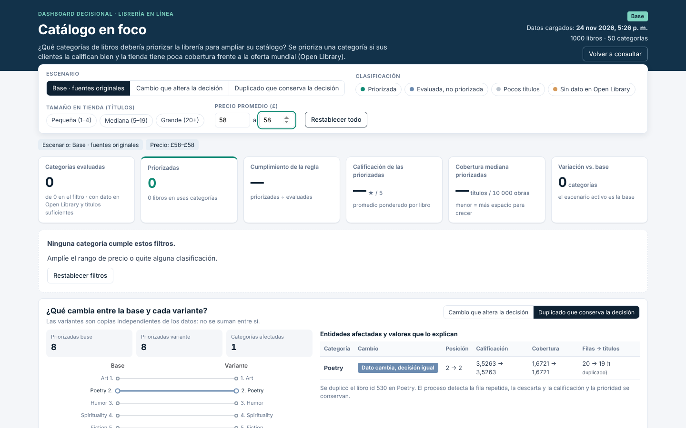

# Catálogo en foco · Dashboard decisional (Reto BI)

Aplicación web de inteligencia de negocios que convierte los datos integrados del **Reto ETL** (web scraping de *Books to Scrape* + API JSON de *Open Library*, cargados en PostgreSQL) en una herramienta para **decidir qué categorías de libros priorizar al ampliar el catálogo** de una librería en línea, sin escribir SQL ni ejecutar notebooks.

**Autor:** Daniel De La Cruz Tomalá · Inteligencia de Negocios · UPSE · 2026-2
**Video de demostración:** _[enlace al video]_



## Problema, audiencia y objetivo

- **Problema:** la librería debe decidir en qué categorías invertir primero. Conviene invertir donde **los clientes califican bien lo que ya hay** y donde **la tienda tiene poca cobertura** frente a la oferta mundial de obras.
- **Audiencia:** responsable de compras y gerente de catálogo (alcance **táctico**, consulta en cada ciclo de compras).
- **Objetivo de negocio:** obtener una lista priorizada y justificada de categorías, ver qué tan sólida es y probar umbrales alternativos antes de comprometer presupuesto.
- **Regla de decisión (del Reto ETL):** priorizar si `calificación ≥ U_R` **y** `cobertura ≤ U_C`, con al menos `N` títulos, donde `cobertura = títulos en tienda / obras en Open Library × 10 000`. Umbrales originales: 3,0 ★ · 5,0 · 5.

Detalle en [docs/diseno.md](docs/diseno.md) (audiencia, decisión, preguntas de negocio, wireframe, granularidad, OLAP y justificación del stack).

## Funcionalidades

| Requisito | Implementación |
|---|---|
| Conexión a PostgreSQL | FastAPI + SQLAlchemy lee `decision_categorias` y `libros` en cada consulta. Las credenciales solo están en el `.env` del servidor. Botón «Volver a consultar» y fecha de carga visible. |
| 6 KPIs | Evaluadas, priorizadas, % de cumplimiento, calificación de las priorizadas, cobertura mediana y variación vs. base. Diccionario en [docs/indicadores.md](docs/indicadores.md). |
| 5 visualizaciones | **Mapa de decisión** (dispersión calificación × cobertura con zona y umbrales) · **ranking** (barras ordenadas) · **composición 1–5 ★** (barras apiladas 100 %) · **comparación de escenarios** (gráfico de pendiente) · **histograma de precios** en el detalle. Además, una tabla de detalle ordenable. |
| Interactividad | Selector de escenario, filtros de clasificación, tamaño en tienda y rango de precio, chips de filtros activos y «Restablecer todo». Drill-down al hacer clic en cualquier gráfico o fila, y roll-up con «Volver a la vista general». |
| Escenarios | Base / cambio que altera la decisión (History entra 8.ª) / duplicado que la conserva (Poetry igual), con las entidades afectadas y los valores que lo explican. |
| Simulador | Sliders U_R, U_C y N: recalcula la clasificación, los KPIs y los gráficos, compara con los umbrales originales (entran / salen) y permite restablecer. **No escribe en la base.** |
| UX | Diseño propio y responsive (de 390 px a escritorio), colores con significado fijo, estados de carga, error y sin resultados, y escenario y filtros siempre visibles. |
| Validación | 13 consultas SQL independientes ([database/validaciones.sql](database/validaciones.sql)) y 8 pruebas `pytest`. Resultados en [docs/validaciones.md](docs/validaciones.md). |
| Hallazgos | 2 hallazgos con cifras y 1 acción recomendada: [docs/hallazgos.md](docs/hallazgos.md) (también en el tablero). |

## Tecnologías

- **Frontend:** React 19 + Vite, Apache ECharts 6 y CSS propio.
- **Backend:** Python 3.10+, FastAPI, SQLAlchemy 2, psycopg2 y pytest.
- **Base de datos:** PostgreSQL 14+ (probado en 16).
- **Opcional:** Docker y Docker Compose.

No se usa Power BI, Streamlit, Tableau, Metabase, Superset, Grafana, Dash ni herramientas equivalentes.

## Arquitectura

```
Navegador (React + ECharts)  ── KPIs, gráficos, filtros, tabla, simulador
        │  fetch /api/...   (sin credenciales; Vite redirige /api en desarrollo)
        ▼
FastAPI  backend/app/main.py      ── validación de parámetros, armado de respuestas
         backend/app/consultas.py ── SQL parametrizado: regla de decisión, KPIs, escenarios
        │  SQLAlchemy + psycopg2  (credenciales en .env)
        ▼
PostgreSQL  decision_categorias (Reto ETL) · libros (ajuste) · v_libros_limpios
```

### Endpoints

| Método | Ruta | Devuelve |
|---|---|---|
| GET | `/api/salud` | prueba de conexión |
| GET | `/api/meta` | escenarios, umbrales originales, fecha de carga, rangos |
| GET | `/api/tablero?escenario&u_rating&u_cobertura&min_titulos&clasificaciones&tamanos&precio_min&precio_max` | KPIs, categorías clasificadas, simulación, composición |
| GET | `/api/comparacion?u_rating&u_cobertura&min_titulos` | diferencias de cada variante frente a la base |
| GET | `/api/categorias/{categoria}/libros?escenario` | libros de la categoría (drill-down) |

La documentación interactiva se abre en `http://localhost:8000/docs`.

## Instalación y ejecución

Requisitos: Python 3.10+, Node.js 18+ y PostgreSQL 14+.

### 1. Inicializar la base de datos

**Opción A · restaurar el respaldo (recomendada, no necesita el ETL):**

```bash
createdb -U postgres reto_etl            # o desde pgAdmin
psql -U postgres -d reto_etl -f database/datos.sql
```

**Opción B · regenerar desde el Reto ETL:** ejecute el notebook del Reto ETL (crea `decision_categorias` con los tres escenarios). Luego cargue la tabla de libros, que reutiliza ese mismo ETL:

```bash
# Windows PowerShell:  $env:RETO_ETL_DIR="C:\ruta\a\reto_etl"
export RETO_ETL_DIR=/ruta/a/reto_etl
python database/cargar_libros.py
```

### 2. Configurar la conexión

Copie `.env.example` como `.env` (en la raíz del repositorio) y complete sus datos de PostgreSQL. El `.env` está en `.gitignore`.

### 3. Backend

```bash
cd backend
python -m venv .venv
# Windows: .venv\Scripts\activate     Linux/Mac: source .venv/bin/activate
pip install -r requirements.txt
uvicorn app.main:app --reload --port 8000
pytest -q          # opcional: 8 pruebas contra la base cargada
```

### 4. Frontend

```bash
cd frontend
npm install
npm run dev        # http://localhost:5173  (redirige /api al backend en :8000)
```

Para servir todo desde un solo puerto: `npm run build` y abra `http://localhost:8000` (FastAPI sirve `frontend/dist`).

### Opción Docker

```bash
docker compose up --build      # http://localhost:8000  (PostgreSQL en el puerto 5433 del host)
```

## Capturas

| | |
|---|---|
|  Simulador: U_R = 2,9 → entran History, Science y Business |  Cambio que altera la decisión |
|  Duplicado que conserva la decisión |  Drill-down: Poetry con el duplicado descartado |
|  Filtros combinados (dice) |  Estado sin resultados |

Vista móvil: [screenshots/08_movil.png](screenshots/08_movil.png) · Tablero completo: [screenshots/00_dashboard_completo.png](screenshots/00_dashboard_completo.png)

## Estructura del repositorio

```
reto-bi/
├── backend/            FastAPI (app/main.py, app/consultas.py, app/db.py), tests/, requirements.txt
├── frontend/           React + Vite + ECharts (src/components/…)
├── database/
│   ├── 01_esquema.sql      esquema (decision_categorias, libros, v_libros_limpios)
│   ├── datos.sql           respaldo completo con los 3 escenarios
│   ├── cargar_libros.py    ajuste: tabla de libros a partir del ETL
│   └── validaciones.sql    13 consultas de validación
├── docs/               diseno.md · wireframe.png · indicadores.md · validaciones.md · hallazgos.md
├── screenshots/
├── Dockerfile · docker-compose.yml
├── .env.example · .gitignore
└── README.md
```

## Limitaciones

- *Books to Scrape* es un portal de práctica: las calificaciones no traen número de reseñas, y no hay ventas ni fechas. Por eso no hay análisis temporal.
- `work_count` de Open Library cambia con el tiempo. Los datos corresponden a la copia del 23/11/2026 usada en el Reto ETL.
- Los hallazgos son descriptivos: no establecen causalidad.
