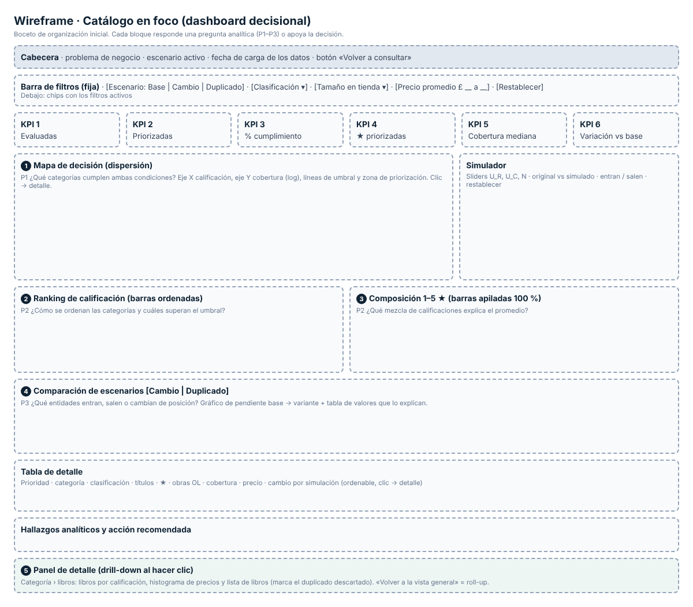

# Diseño del dashboard (antes de implementar)

## Definición

| Elemento | Definición |
|---|---|
| **Audiencia** | Responsable de compras y gerente de catálogo de una librería en línea (la tienda *Books to Scrape*). Conocen el negocio, no SQL. |
| **Decisión** | **Priorizar** en qué categorías de libros ampliar el catálogo primero. |
| **Alcance** | **Táctico**: orienta la asignación del presupuesto de compras del siguiente ciclo, no la estrategia de toda la empresa ni la operación diaria. |
| **Frecuencia** | Cada vez que se planifica una compra (mensual o trimestral) o cuando se vuelven a extraer las fuentes con el ETL. También se usa para probar «¿qué pasa si exigimos más calificación?» antes de una reunión de compras. |

## Preguntas de negocio

| # | Pregunta | Dónde se responde |
|---|---|---|
| P1 | ¿Qué categorías cumplen a la vez las dos condiciones de la regla (buena calificación **y** poca cobertura frente a la oferta mundial)? | KPIs 1–3, mapa de decisión, tabla de detalle |
| P2 | ¿Qué tan sólida es la calificación de cada categoría: cuánto supera el umbral y qué mezcla de 1 a 5 ★ hay detrás del promedio? | Ranking de calificación, composición de calificaciones, drill-down |
| P3 | ¿Qué tan sensible es la decisión: qué categorías entran, salen o cambian de puesto si cambia un dato (escenarios) o un umbral (simulador)? | Comparación de escenarios, simulador, KPI 6 |

## Regla de decisión (heredada del Reto ETL)

```
cobertura = n_titulos / work_count × 10 000          (títulos en tienda por cada 10 000 obras en Open Library)
priorizar = coincide_b  AND  n_titulos ≥ N  AND  rating_promedio ≥ U_R  AND  cobertura ≤ U_C
orden     = rating_promedio DESC, cobertura ASC
Umbrales originales: U_R = 3,0 ★ · U_C = 5,0 · N = 5
```

## Wireframe



Principio aplicado: **cada componente responde una pregunta (P1–P3) o apoya la decisión**. Por eso **no hay gráfico de líneas**: los datos no tienen dimensión temporal (los escenarios son variantes de los mismos datos, no periodos).

## Datos y granularidad

| Objeto en PostgreSQL | Origen | Granularidad (una fila =) | Uso en el dashboard |
|---|---|---|---|
| `decision_categorias` | Reto ETL (sin cambios) | una **categoría** de la tienda en un **escenario** (50 × 3 = 150 filas) | KPIs, mapa, ranking, tabla, simulador, escenarios |
| `libros` | **Ajuste para el Reto BI** (`database/cargar_libros.py`, reutiliza el mismo ETL) | un **libro** extraído en un escenario, incluido el registro duplicado marcado con `es_duplicado` (3001 filas) | composición de calificaciones, drill-down, histograma de precios |
| `v_libros_limpios` | vista | un libro único (sin duplicados) | composición y validación del KPI 4 |

Consultas: todas están en `backend/app/consultas.py` (parametrizadas, solo lectura). La regla se recalcula en SQL con los umbrales del simulador como **parámetros**; nunca se escriben en la base.

## Elección del stack

| Criterio | Decisión |
|---|---|
| **Conectividad** | **FastAPI + SQLAlchemy + psycopg2**: mismo lenguaje y mismo driver que el Reto ETL; las credenciales viven solo en el `.env` del servidor. |
| **Facilidad de desarrollo** | FastAPI valida los parámetros (rangos de umbrales, escenarios permitidos) y responde 422 sin código extra. **React + Vite** recarga al instante. |
| **Personalización** | **Apache ECharts** permite dibujar la zona de decisión, líneas de umbral, escala logarítmica y el gráfico de pendiente, que no vienen listos en plantillas de dashboard. Estilos propios en CSS (sin tema prefabricado). |
| **Mantenibilidad** | Componentes React reutilizables (`Grafico`, `Kpis`, `Simulador`…), consultas SQL en un solo módulo y 8 pruebas automáticas con `pytest`. |
| **Despliegue** | `docker compose up` levanta PostgreSQL con `datos.sql` y la app. En producción, FastAPI también sirve el frontend compilado: un solo proceso. |

## Relación con OLAP

| Operación | Cómo se aplica |
|---|---|
| **Slice** | Elegir un escenario fija una dimensión (`escenario = 'cambio_decision'`). |
| **Dice** | Combinar escenario + clasificación + tamaño + rango de precio filtra un subcubo; KPIs, gráficos y tabla se recalculan sobre él. |
| **Drill-down** | Clic en una categoría (mapa, ranking, composición o tabla) → panel con sus **libros**, distribución de estrellas y de precios. |
| **Roll-up** | «Volver a la vista general» (o Esc) regresa del nivel libro al nivel categoría; los KPIs resumen todas las categorías en un total. |
